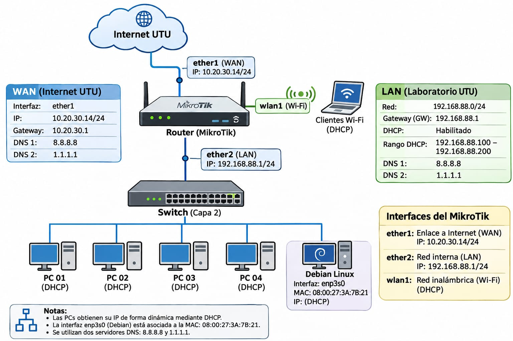

# `registro.ps1` — Agente de diagnóstico e inventario de equipos

## 1. Propósito

Script de PowerShell que corre como **agente en segundo plano** (vía Tarea Programada de
Windows) en cada PC de los laboratorios, repitiéndose cada cierto intervalo — de forma
similar a un agente de monitoreo tipo Zabbix, pero implementado con las herramientas nativas
de Windows en lugar de un servicio dedicado, dado que este proyecto corre en un entorno de
prueba/laboratorio. En cada corrida recolecta información de diagnóstico del equipo
(hardware, sistema operativo, red, estado de conectividad) y:

1. Guarda un archivo `.toml` local (uno por equipo por día, se sobrescribe en corridas
   sucesivas del mismo día) como respaldo, y un log (`agente.log`) con el resultado de cada
   corrida — ver [Datos locales del agente](#3b-datos-locales-del-agente).
2. Envía un reporte en JSON a la API del sistema (`public-WEB/api/api_registro.php`), que lo
   guarda en la base de datos (`bddsglab6`), dando de alta o actualizando el equipo en la
   tabla `Equipos` y creando un registro de uso en la tabla `Registro`.

Ubicación: [`ps/registro.ps1`](../ps/registro.ps1). Instalador del agente (Tarea Programada):
[`ps/instalar-agente.ps1`](../ps/instalar-agente.ps1).

## 2. Requisitos

- Windows con PowerShell 5.1+ (o PowerShell 7).
- Política de ejecución que permita correr el script (ver [Instalación](#4-instalación)).
- `ssh-keygen` disponible en PATH si todavía no existe una clave SSH (`~/.ssh/id_rsa`).
- Conectividad de red hacia el servidor Docker donde corre `sglab_web` (puerto `8080`).

## 3. Configuración

Las variables se configuran al principio del script (`ps/registro.ps1`, líneas 6-12):

| Variable | Valor por defecto | Descripción |
|---|---|---|
| `$apiUrl` | `$env:SGLAB_API_URL` o `http://192.168.88.10:8080/api/api_registro.php` | URL del endpoint. Debe apuntar a la IP del host donde corre el contenedor `sglab_web`. Al igual que `$apiKey`, se puede sobreescribir con la variable de entorno `SGLAB_API_URL` sin tocar el script — útil porque la IP cambia según la red donde se despliegue (pruebas vs. laboratorio real). |
| `$apiKey` | `$env:SGLAB_API_KEY` o `"CAMBIAR_ESTA_CLAVE"` | Debe coincidir **exactamente** con `API_SECRET_KEY` en `public-WEB/.env`. Se recomienda definirla como variable de entorno de usuario/sistema (`SGLAB_API_KEY`) en vez de dejarla hardcodeada en el script. |
| `$laboratorio` | `"Laboratorio 6"` | Debe coincidir con un valor existente en `Laboratorios.nombre` de la base de datos; si no matchea ninguno, el equipo se guarda sin laboratorio asignado. |
| `$clavePrivada` | `~\.ssh\id_rsa` | Ruta de la clave SSH privada del usuario (se usa solo para reportar la ruta en el TOML, no se envía la privada). |

**Generar una clave de API válida** (en el servidor, no en el script):

```bash
openssl rand -hex 32
```

Copiar ese valor en `public-WEB/.env` (`API_SECRET_KEY=...`) y en la variable de entorno
`SGLAB_API_KEY` de cada PC Windows (o reemplazar el valor por defecto en el script).

> Mientras `API_SECRET_KEY` tenga el valor placeholder `CAMBIAR_ESTA_CLAVE`, el endpoint
> rechaza cualquier reporte con `503 La API no está configurada en el servidor`.

## 3b. Datos locales del agente

Como el agente corre repetidamente en segundo plano (no una sola vez), ya no escribe en el
Escritorio del usuario. Usa una carpeta propia:

| Archivo | Ruta | Contenido |
|---|---|---|
| Reporte TOML | `%LOCALAPPDATA%\SGLAB\Reportes\<fecha>-<nombrePC>-<serial>.toml` | Snapshot legible del último diagnóstico del día (se sobrescribe en cada corrida del mismo día). |
| Log del agente | `%LOCALAPPDATA%\SGLAB\agente.log` | Una línea por corrida con resultado (`OK`/`ERROR`) — útil para depurar corridas en segundo plano, donde no hay consola visible. |

## 4. Instalación

### Instalación como agente en segundo plano (recomendada)

Con una consola de PowerShell o CMD en modo **Administrador**, ejecutar `setup.bat` (o
directamente `ps/instalar-agente.ps1`). Esto:

1. Registra la Tarea Programada de Windows `SGLAB-Agente-Inventario`, que ejecuta
   `registro.ps1` oculto (`-WindowStyle Hidden`) cada 15 minutos (parámetro
   `-intervaloMinutos`, configurable) de forma indefinida.
2. Crea un acceso directo en el Escritorio para forzar una ejecución manual bajo demanda.

```powershell
Set-ExecutionPolicy Unrestricted -Scope Process -Force
.\instalar-agente.ps1                      # cada 15 min, mientras el usuario tenga sesión iniciada
.\instalar-agente.ps1 -intervaloMinutos 5  # otro intervalo
.\instalar-agente.ps1 -sinSesionIniciada   # corre como SYSTEM, incluso sin nadie logueado
```

Comandos útiles una vez instalado:

```powershell
Get-ScheduledTask -TaskName "SGLAB-Agente-Inventario" | Get-ScheduledTaskInfo
Start-ScheduledTask -TaskName "SGLAB-Agente-Inventario"   # forzar una corrida ya
Unregister-ScheduledTask -TaskName "SGLAB-Agente-Inventario" -Confirm:$false  # desinstalar
```

**Nota:** a la fecha de este documento, `setup.bat` referencia el archivo
`registro-estudiante.lnk`, pero el acceso directo real en el repositorio se llama
`generar_registro.ps1 - Estudiante.lnk` — por el nombre distinto, esa copia del acceso
directo falla silenciosamente (el resto de la instalación funciona igual).

## 5. Flujo de ejecución

1. **Gestión de clave SSH** (`New-SSHKey`): reutiliza `~\.ssh\id_rsa.pub` si existe, o la
   genera con `ssh-keygen` si no.
2. **Conectividad**: resuelve el gateway por defecto y hace ping para determinar
   `estado` (`Exito` / `Fallo` / `Error`).
3. **Inventario de hardware**: SO, IP, CPU, uso de CPU, RAM total/uso, disco (tipo, total,
   libre, % uso) vía `Get-CimInstance` / `Get-NetIPAddress` / `Get-PhysicalDisk`.
4. **Cédula del responsable** (opcional): si se invoca con `-cedula <valor>` distinto de 0,
   pide la cédula por consola y la valida con el algoritmo de dígito verificador uruguayo
   (`Test-CedulaUruguaya`). En modo desatendido (`-cedula 0`, valor por defecto) no pide nada.
5. **Archivo TOML local**: guarda un resumen legible en
   `%LOCALAPPDATA%\SGLAB\Reportes\<fecha>-<nombrePC>-<serial>.toml` (ver
   [Datos locales del agente](#3b-datos-locales-del-agente)).
6. **Envío a la API**: arma un JSON y hace `POST` a `$apiUrl` con el header `X-API-KEY`.

### Ejecución manual

```powershell
# Modo desatendido (sin pedir cédula)
.\registro.ps1

# Pidiendo la cédula del responsable
.\registro.ps1 -cedula 1
```

## 6. Payload enviado a la API

`POST $apiUrl`, header `X-API-KEY: <clave>`, cuerpo JSON (UTF-8):

| Campo | Origen | Obligatorio en la API |
|---|---|---|
| `serial` | Número de serie de BIOS (o hostname si no hay serie) | Sí |
| `hostname` | `$env:COMPUTERNAME` | Sí |
| `laboratorio` | Variable `$laboratorio` del script | No (si no matchea, queda sin asignar) |
| `cedula` | Cédula ingresada (o `0` en modo desatendido) | No |
| `estado` | `true` si hubo ping exitoso al gateway | No |
| `ip`, `mascara`, `gateway` | Datos de red detectados | No |
| `so`, `so_version` | `Win32_OperatingSystem` | No |
| `usuario_windows` | `$env:USERNAME` | No |
| `cpu` | `Win32_Processor.Name` | Sí |
| `ram_gb` | RAM total en GB | Sí |
| `disco_tipo` | Tipo de disco físico (SSD/HDD/NVMe/Desconocido) | Sí |
| `disco_total_gb`, `disco_libre_gb` | Capacidad y espacio libre del disco `C:` | `disco_total_gb` sí |
| `cpu_uso`, `ram_uso`, `disco_uso` | Porcentajes de uso | No |

## 7. Qué hace el servidor con esos datos (`api_registro.php`)

Endpoint: [`public-WEB/api/api_registro.php`](../public-WEB/api/api_registro.php)

1. Valida el header `X-API-KEY` contra `API_SECRET_KEY` (`.env`) con `hash_equals`.
2. Valida que el body sea JSON y tenga los campos obligatorios.
3. Busca el equipo por `serial` en la tabla `Equipos`:
   - Si no existe, lo da de alta (`Equipo::crearEquipo`) — rechaza con `409` si ya hay otro
     equipo con el mismo `hostname` pero distinto `serial`.
   - Si ya existe, actualiza hardware y hostname (`Equipo::actualizarEquipo`), conservando el
     laboratorio ya asignado si lo tenía.
4. Busca al responsable por `cedula` en `Usuarios.ci`; si no se encuentra (o no se envió
   cédula), usa el usuario del sistema (`ID_USUARIO_SISTEMA = 1`).
5. Inserta una fila en `Registro` (equipo, usuario, fecha, estado de conexión, IP, espacio
   libre en disco, y una descripción generada automáticamente con SO/uso de recursos).
6. Responde `201 Registro guardado` con `idEquipo`, si el equipo era nuevo, y si quedó
   asignado a un laboratorio.

## 8. Troubleshooting

| Síntoma | Causa probable | Solución |
|---|---|---|
| `503 La API no está configurada en el servidor` | `API_SECRET_KEY` en `.env` sigue en `CAMBIAR_ESTA_CLAVE` | Generar clave con `openssl rand -hex 32` y configurarla en `.env` y en el script/variable de entorno. |
| `401 Acceso no autorizado` | La clave del script no coincide con `API_SECRET_KEY` | Verificar que `$env:SGLAB_API_KEY` (o el valor por defecto del script) sea idéntico al de `.env`. |
| `409 Ya existe otro equipo con ese hostname y distinto serial` | Dos equipos reportando el mismo hostname (ej. clonado de imagen sin cambiar nombre) | Renombrar el equipo o corregir el serial reportado. |
| El agente no corre periódicamente | La Tarea Programada no se instaló, o la política de ejecución bloquea el `.ps1` | Re-ejecutar `setup.bat` (o `instalar-agente.ps1`) como administrador; verificar `Get-ScheduledTask -TaskName "SGLAB-Agente-Inventario"` y `Get-ExecutionPolicy`. |
| No se ve ningún resultado de las corridas en segundo plano | Es esperable: el agente corre oculto, sin consola | Revisar `%LOCALAPPDATA%\SGLAB\agente.log` y el historial de la tarea en el Programador de tareas (`Get-ScheduledTaskInfo`). |
| No se pudo enviar el reporte (timeout / conexión rechazada) | `$apiUrl` no alcanza al servidor, puerto 8080 cerrado, o contenedor caído | Verificar `docker ps`, que el host esté en la misma red, y que `$apiUrl` tenga la IP correcta. El TOML local igual queda guardado en `%LOCALAPPDATA%\SGLAB\Reportes\` como respaldo, y el error queda en `agente.log`. |

## 9. Diagrama de red del laboratorio



Resumen de la topología:

| Segmento | Interfaz MikroTik | Red / IP | Notas |
|---|---|---|---|
| WAN (Internet UTU) | `ether1` | `10.20.30.14/24`, gateway `10.20.30.1` | DNS `8.8.8.8` / `1.1.1.1` |
| LAN (Laboratorio) | `ether2` | `192.168.88.0/24`, gateway `192.168.88.1` | DHCP habilitado, rango `192.168.88.100`–`192.168.88.200` |
| Wi-Fi | `wlan1` | Misma LAN, DHCP | Clientes inalámbricos |
| Switch (capa 2) | — | — | Conecta PC 01–04 y el servidor Debian |
| Servidor Debian | `enp3s0` | DHCP (dentro de `192.168.88.0/24`) | MAC `08:00:27:3A:7B:21` — es donde corre este proyecto (Docker: `sglab_web`, `sglab_db`) |

> ⚠️ **Importante:** `$apiUrl` (o la variable de entorno `SGLAB_API_URL`, ver sección 3) tiene
> que apuntar a la IP real del servidor dentro de `192.168.88.0/24`. Lo ideal es asignarle al
> servidor una IP estática fuera del rango DHCP (p. ej. `192.168.88.10`) para que no cambie y
> no haya que volver a tocar el script en cada PC cuando eso pase.

### Si el servidor corre en Windows + WSL2 (Docker Desktop)

Si quien levanta el `docker-compose.yml` lo hace sobre Windows con Docker Desktop en WSL2 (en
vez de un servidor Linux nativo como el Debian del diagrama), hay un paso extra: **WSL2 usa
NAT**, así que Windows solo reenvía automáticamente a WSL el tráfico que llega por
`localhost` del propio equipo — no el que llega desde otra PC de la red al puerto 8080. Sin
este paso, aunque `docker compose ps` muestre el puerto publicado, las PCs del laboratorio no
van a poder alcanzar la API (quedan en timeout).

Se soluciona una vez, en la PC que corre Docker, con los scripts en
[`public-WEB/docker/`](../public-WEB/docker/):

```powershell
# Como Administrador, en la PC que corre Docker (no en las PCs de los alumnos):
cd public-WEB\docker
.\instalar-exposicion-wsl.ps1
```

Esto registra una Tarea Programada que reenvía el puerto 8080 hacia la IP interna de WSL y
abre la regla de firewall correspondiente, y la vuelve a aplicar en cada arranque de Windows
(la IP interna de WSL cambia en cada reinicio, así que hay que reaplicarlo cada vez — por eso
va como tarea programada y no como paso manual único). Ver
[`exponer-wsl-en-red.ps1`](../public-WEB/docker/exponer-wsl-en-red.ps1) para correrlo a mano
o entender qué hace exactamente.

## 10. Scripts relacionados

- [`ps/registro_perifericos.ps1`](../ps/registro_perifericos.ps1) — variante centrada en
  periféricos conectados.
- [`ps/instalar-agente.ps1`](../ps/instalar-agente.ps1) — registra la Tarea Programada del
  agente (ver sección 4).
- [`ps/setup.bat`](../ps/setup.bat) — instalador de conveniencia: llama a
  `instalar-agente.ps1` y crea el acceso directo del Escritorio.
- [`ps/sendEmail.ps1`](../ps/sendEmail.ps1) — envío de notificaciones por correo.
- [`public-WEB/docker/exponer-wsl-en-red.ps1`](../public-WEB/docker/exponer-wsl-en-red.ps1) y
  [`instalar-exposicion-wsl.ps1`](../public-WEB/docker/instalar-exposicion-wsl.ps1) — del lado
  servidor (no de las PCs del laboratorio): exponen a la red el puerto de Docker cuando el
  servidor corre sobre Windows + WSL2 (ver sección 9).
